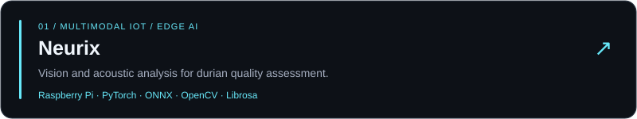
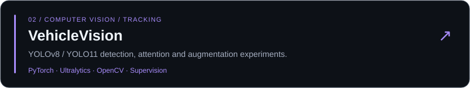
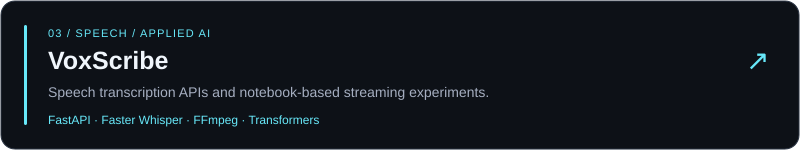
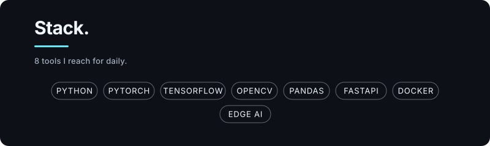

  

  
  

  <strong>AI Undergraduate · Computer Vision &amp; Applied AI</strong> 
  Can Tho, Vietnam · FPT University · Expected graduation: 2027

  
  
  
  
  
  
  

## Research highlights

- **FETC 2025 · Co-author** — Comparative study of mBART-50 and NLLB for low-resource English–Vietnamese translation.
- **Outstanding Student in Scientific Research · April 2026** — FPT University.
- **Research Festival 2026 · Finalist, Team KPC** — Multimodal IoT-based durian quality assessment using vision and acoustic analysis on Edge AI devices.

## About me

I'm an Artificial Intelligence undergraduate at FPT University, working toward a career in **Computer Vision and real-time intelligent systems**. During my AI internship at **FPT Software, Quy Nhon**, I worked on vision and multimodal pipelines, homography-based spatial mapping, and cross-camera object tracking with ReID. I also co-authored a paper on low-resource English–Vietnamese translation published in the **FETC 2025 conference proceedings** and received recognition for excellence in student research.

My portfolio spans detection and tracking, deepfake classification, speech processing, sentiment analysis, and AI-enabled applications. I'm interested in robust perception under low light, occlusion and adverse weather, and in turning model experiments into usable systems.

| Focus | Experience & interests |
| :--- | :--- |
| **Computer vision** | YOLO, multi-object tracking, ByteTrack, ReID / OSNet, homography, transfer learning |
| **Applied AI** | VLM / LLM pipelines, image–audio fusion, speech recognition, model optimization |
| **Engineering** | Python, FastAPI, Docker, Git, Raspberry Pi; web application projects |
| **Research** | Low-resource machine translation; FETC 2025 co-authored paper; interests in computer vision and reinforcement learning |

## Selected projects

<strong>More project details & contributions</strong>

### Project contributions

### 🍈 [Neurix — Multimodal Edge AI](https://github.com/JayC0603/Neurix)

Durian ripeness classification on Raspberry Pi using camera and impact-audio inputs, with servo tapping, an LCD and a real-time dashboard. Connects model inference with a physical device workflow.

**Stack:** Python · PyTorch · ONNX Runtime · OpenCV · Librosa · Raspberry Pi

### 🚗 [VehicleVision — Detection & Tracking](https://github.com/JayC0603/YOLO-VehicleVision-Advanced-Vehicle-Detection-and-Tracking-System)

YOLOv8 / YOLO11 experiments for vehicle detection and tracking, including coordinate attention, Albumentations and oversampling. Compares model behavior using detection metrics and tracking visualizations.

**Stack:** PyTorch · Ultralytics · OpenCV · Supervision · Albumentations

### 💬 [Allianz — Sentiment Analysis](https://github.com/JayC0603/Allianz-Travel-Insurance-Sentiment-Analysis-Project)

Contributed to an end-to-end pipeline for approximately **10,000 Trustpilot reviews**, from automated collection and text preprocessing to TF-IDF features and model comparison. The project reported **86% accuracy with XGBoost** and included an LSTM baseline.

**Stack:** Python · scikit-learn · XGBoost · TensorFlow / Keras · NLTK · Selenium

### 🕵️ [Real-Time Deepfake Detection](https://github.com/JayC0603/Real-Time-Deepfake-Detection)

Contributed to neural-network experiments for deepfake classification, model evaluation and exploration of real-time inference constraints. The repository includes PyTorch and TensorFlow / Keras experiments, transfer learning and TensorFlow Lite conversion.

**Stack:** Python · PyTorch · TensorFlow / Keras · OpenCV · Flask

## Core toolkit

## 🎨 Technologies across my projects

My core focus is Python, computer vision and applied AI. The expanded toolkit below reflects technologies used across my public projects and experiments.

<strong>Explore the full technology stack — AI, data, web & deployment</strong>

### 🧠 Machine learning & deep learning

  
  
  
  
  
  

TorchVision · timm · TensorFlow Lite · Keras Tuner

### 👁️ Computer vision

  
  
  
  
  
  

YOLOv8 / YOLO11 · vehicle tracking · image classification

### 📊 Data analysis & visualization

  
  
  
  
  
  
  

### 💬 NLP, speech & language models

  
  
  
  
  
  
  
  
  

VoxScribe also explores Sherpa-ONNX, NVIDIA NeMo, Zipformer and Sortformer in its Kaggle streaming notebook. Its local backend uses Faster Whisper.

### 🌐 Languages & web development

  
  
  
  
  
  
  
  
  
  
  
  
  
  
  
  

SoftSync runs on ASP.NET Core / Blazor Server. Its Next.js / React frontend is being developed as a migration. API tooling includes Uvicorn and Pydantic.

### 🗄️ Database, deployment & hardware

  
  
  
  
  
  
  
  
  

Docker Compose · GPIO Zero · lgpio · RPi.GPIO · I²C / smbus2 · RPLCD · sounddevice · xUnit

## Experience

**AI Intern (OJT) · FPT Software, Quy Nhon** 
*January 7 – April 11, 2026*

- Developed and supported AI pipelines involving computer vision and VLM / LLM models.
- Applied homography transformations for spatial mapping and multi-camera scenarios.
- Implemented ReID techniques for cross-camera object tracking.

**Technical Employee · NFT BY VIETKHOA** 
*2023 – November 2025*

- Troubleshot mobile devices, laptops and VR headsets, and installed and maintained software across platforms.
- Worked with customers to diagnose technical issues and helped document support procedures.

## Research & publications

**Low-Resource English-Vietnamese Translation: A Comparative Study of mBART-50 and NLLB** 
*Co-author · Published in the proceedings of the 2025 1st FPT International Conference on Emerging Trends in Computing (FETC 2025)*

A comparative study of mBART-50 and NLLB for low-resource English–Vietnamese machine translation.

**Authors:** Nguyen Vu Huy, Nguyen Thi Bich Tuyen, Dang Hoang Kiet, **Nguyen Minh Chanh**, Dinh Van Anh Khoi, Nguyen Khanh Trinh, and Nguyen Dinh Vinh.

## Education & recognition

**Bachelor of Artificial Intelligence · FPT University** 
*2022 – present · Expected graduation: 2027*

- **Outstanding Student in Scientific Research (Sinh viên xuất sắc trong nghiên cứu khoa học)** — FPT University, April 2026; recognized for the research work published in the FETC 2025 proceedings.
- **Research Festival 2026 Finalist · Team KPC · Team Member** — Research project: *A Multimodal IoT-Based Durian Quality Assessment System Using Vision and Acoustic Analysis on Edge AI Devices*.
- **Consolation Prize** — FPTU Can Tho Olympic AI Competition, May 2026.
- **Two Second Prizes** — Vovinam Competition, March 2023.

<strong>Certifications & community activities</strong>

| Certification | Institution | Completed |
| :--- | :--- | :--- |
| IBM Full Stack Software Developer | IBM | January 2025 |
| Software Development Lifecycle | University of Minnesota | September 2024 |
| Ethics in the Age of AI | LearnQuest | May 2024 |
| AI Foundations for Everyone: A Practical Intro for Beginners | IBM | February 2024 |
| Academic Skills for University Success: Capstone | The University of Sydney | July 2023 |

**WEGO Volunteer Club · May 2023 – December 2024** 
Participated in the *Hat Ngoc Tinh* (Seeds of Love) project, preparing free meals and supporting underprivileged children.

Outside of tech: reading, chess and Chinese chess.

<strong>Browse all nine projects</strong>

## 🚀 Project portfolio

| Project | Explore |
| :--- | :--- |
| 🌌 **[SoftSync](https://github.com/JayC0603/SoftSync)** | Personalized soft-skills learning with AI assistance and roleplay. **C#, ASP.NET Core, Blazor, PostgreSQL, EF Core, Docker**; Next.js / React frontend migration. |
| 🍈 **[Neurix](https://github.com/JayC0603/Neurix)** | AI-powered durian ripeness classification on Raspberry Pi, combining camera and audio input with a real-time dashboard. |
| 🎙️ **[VoxScribe](https://github.com/JayC0603/VoxScribe)** | Speech transcription with **FastAPI, Faster Whisper and FFmpeg**; separate Kaggle streaming experiments with Sherpa-ONNX, Transformers and NeMo. |
| 🤖 **[vilms-gateway](https://github.com/JayC0603/vilms-gateway)** | OpenAI-compatible language and vision-language model gateway using **FastAPI, Ollama / vLLM, Sentence Transformers and Docker**. |
| 🚗 **[VehicleVision](https://github.com/JayC0603/YOLO-VehicleVision-Advanced-Vehicle-Detection-and-Tracking-System)** | Vehicle detection and tracking with YOLO. |
| 🕵️ **[Real-Time Deepfake Detection](https://github.com/JayC0603/Real-Time-Deepfake-Detection)** | Exploring real-time deepfake detection. |
| 🎵 **[Spotify Music Analysis](https://github.com/JayC0603/Spotify-Music-Data-Analysis-and-Clustering)** | Music data analysis and clustering in Jupyter notebooks. |
| 💬 **[Allianz Sentiment Analysis](https://github.com/JayC0603/Allianz-Travel-Insurance-Sentiment-Analysis-Project)** | Review scraping and sentiment classification using **Selenium, BeautifulSoup, NLTK, VADER, XGBoost and TensorFlow / Keras**. |
| 🎓 **[Campus Event Management](https://github.com/JayC0603/Building-a-Campus-Event-Management-System-with-Role-Based-Access)** | Event registration, role-based access and reports, with Python CLI and Flask web variants. **Python, Flask, HTML, CSS, JavaScript, JSON / CSV**. |

  <a href="https://github.com/JayC0603?tab=repositories">✨ See all my repositories →</a>

## Let's connect

Interested in computer vision, multimodal AI and research collaboration.

**[ChanhNMCE180818@fpt.edu.vn](mailto:ChanhNMCE180818@fpt.edu.vn)** · **[GitHub @JayC0603](https://github.com/JayC0603)**

---

  Toolkit adapted from <a href="https://github.com/ryanpolasky/ryme.md">RyMe.md</a> · Custom animated banner &amp; project cards for JayC

